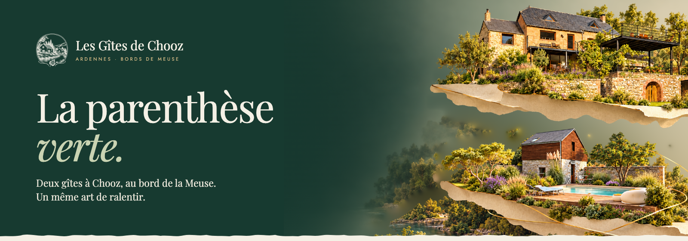
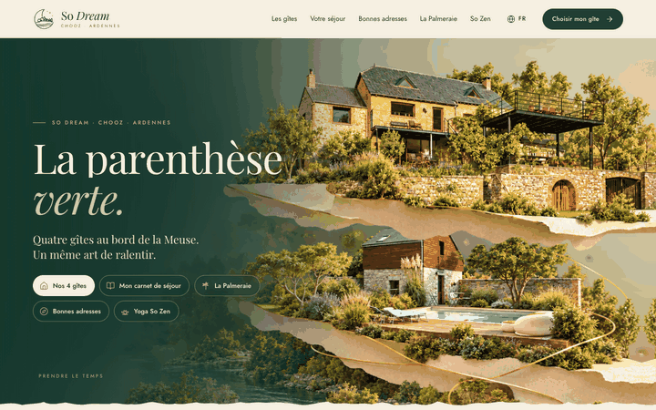
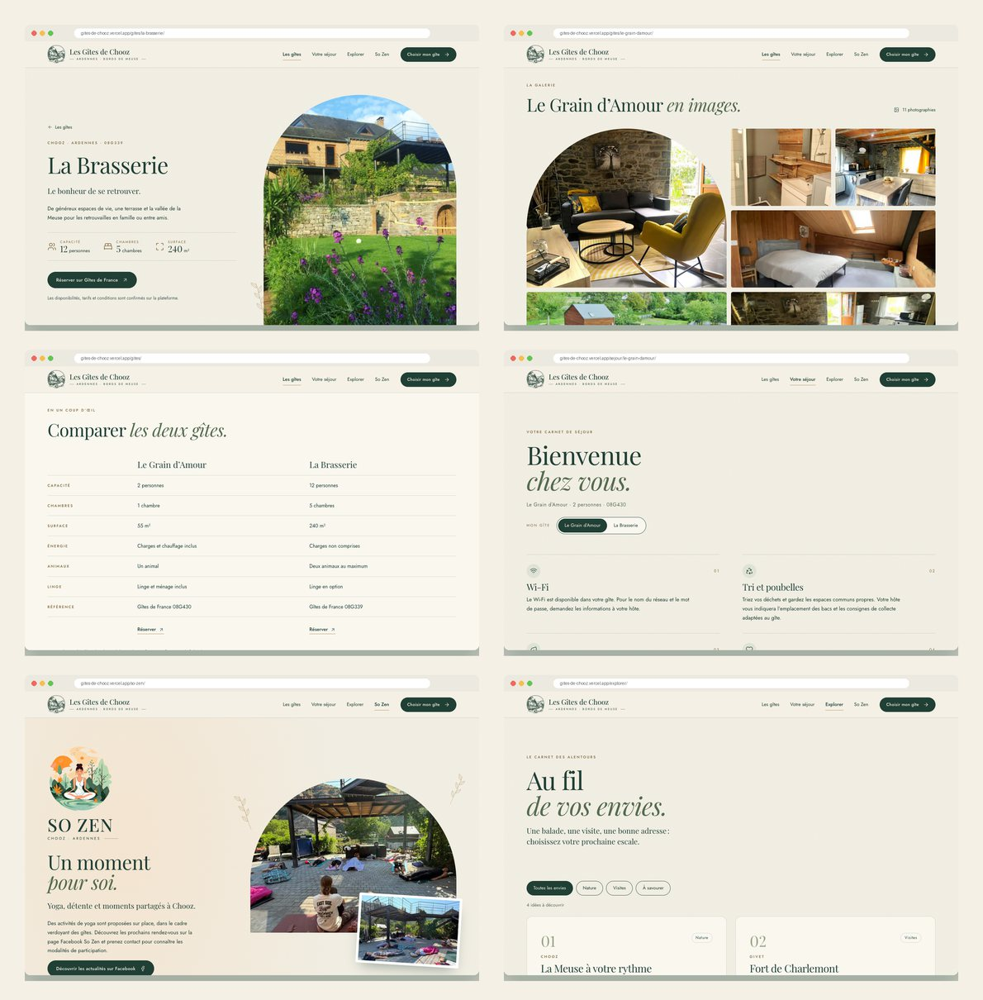
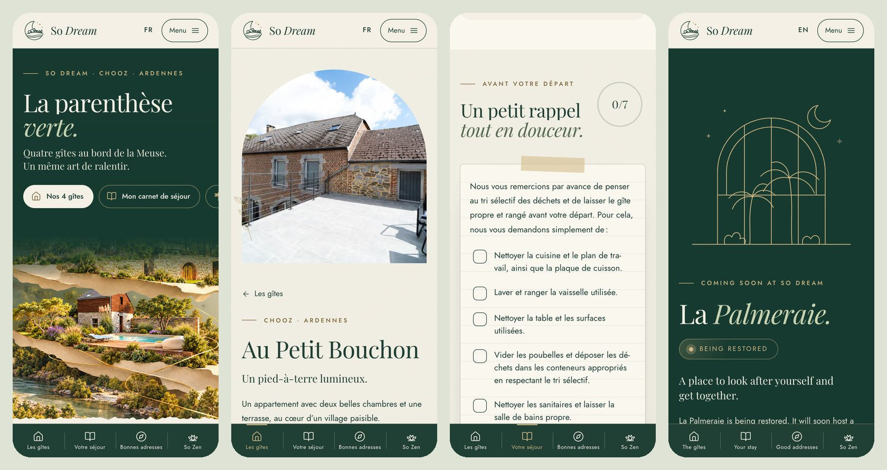
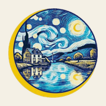

<div align="center">



<h3>A seven-language guest site for four holiday homes in the French Ardennes, opened by a scroll-driven 2.5D landscape and choreographed section by section.</h3>

<p>
  <a href="https://gites-de-chooz.vercel.app"><strong>🌐 Live site</strong></a>
  &nbsp;·&nbsp;
  <a href="#motion"><strong>🎬 The motion system</strong></a>
  &nbsp;·&nbsp;
  <a href="#getting-started"><strong>🛠️ Run it locally</strong></a>
</p>

<p>
  <a href="https://gites-de-chooz.vercel.app"></a>
  
  
  
  
</p>

</div>

<br />

## 🚀 Overview

**So Dream** gathers four holiday homes in Chooz, a village in a loop of the Meuse, under one name, one logo and one QR code:

| Gîte                 | Guests | Bedrooms | Booking                                   |
| :------------------- | :----: | :------: | :---------------------------------------- |
| **Le Grain d’Amour** |   2    |    1     | Gîtes de France (08G430)                  |
| **La Brasserie**     |   12   |    5     | Gîtes de France (08G339)                  |
| **Chez Suzanne**     |   8    |    4     | Gîtes de France (08G466), Booking, Airbnb |
| **Au Petit Bouchon** |   4    |    2     | Airbnb                                    |

The site serves two kinds of visitors:

- **People planning a stay** compare the four houses, browse the owner’s photos and continue to the right platform for each house.
- **Guests already there** scan the card left in their gîte and land on its **carnet de séjour**: Wi-Fi availability, a searchable recycling guide, energy, pets and linen, arrival and departure times, and the owner’s departure reminder as a checklist that remembers what is done.

Around them: **La Palmeraie**, the spa, billiards and event space being restored; **Bonnes adresses**, the owner’s list of bakeries, tables, shops, pharmacies, outings and towns, with an agenda that removes past dates by itself; and **So Zen**, the yoga sessions held on the terrace.

- **Short home page, deep site**: five buttons in the hero lead straight to the gîtes, the guest booklet, La Palmeraie, the addresses and So Zen
- **Seven languages**: French, English, German, Spanish, Dutch, Polish and Turkish, each with its own URLs
- **A distinct motion for every section**, all of it optional: reduced motion and no-JavaScript visitors get a complete, still site
- **Real facts only**: capacities, platforms and times come from the public listings; nothing is invented, and the Wi-Fi network name and password stay in the house

<br />

<a name="motion"></a>

## 🎬 The motion system

<div align="center">
  <a href="https://gites-de-chooz.vercel.app"></a>
  <sub>Scroll-scrubbed on the live site · captured at 1440 × 900</sub>
</div>

<br />

The hero is a short sticky section that follows the kit’s motion script, *Les maisons s’ouvrent sur le paysage*: the two houses open apart on their paper tiers and a brass thread draws itself between them, then flows down into the next section’s eyebrow. Everything below it has its own choreography (GSAP 3.13 with ScrollTrigger, SplitText, DrawSVG, MotionPath and Flip):

| Section                    | Choreography                                                                                          |
| :------------------------- | :---------------------------------------------------------------------------------------------------- |
| Hero                       | Title rises letter by letter from a mask, the quick buttons spring in; the copy drifts away as the houses open |
| Gîtes carousel             | The four houses are dealt in like cards, arches open from the bottom; photos drift inside their arch as you drag |
| Guest band                 | Words surface from a blur, icons draw themselves; a giant marquee speeds up, reverses and leans with scroll velocity |
| So Zen                     | The photo opens as an iris with the scroll; the logo spins in; a ring breathes *Inspirez · Expirez* on an 8-second cycle |
| La Meuse                   | The river draws itself from Charleville to Namur, a paper boat sails down it, towns light up as it passes Chooz |
| Page titles                | Letters flip up in 3D, one after the other                                                             |
| Gîte page                  | The lead photo unveils and zooms out, figures count up, gallery tiles uncover from alternating sides, conditions flip down like cards |
| Guest booklet              | Items rise as you read, the recycling bins bounce in, the departure note lands like a pinned paper; ticks draw, a ring fills, a stamp lands at 7/7 |
| La Palmeraie               | A curtain parts, then the glasshouse and its palms are drawn line by line under a twinkling sky        |
| Bonnes adresses            | Cards glide to their new place when filtered (Flip); trail cards carry their waymark colour; agenda dates fall like calendar pages |
| Guide band                 | The forest panel widens from a rounded card to full width as it scrolls in                            |
| Footer                     | The painted moon rolls in like a rising moon, then *SO DREAM* rises letter by letter                    |
| Between pages              | Cross-document View Transitions fade and lift the new page in                                           |

**Built to degrade gracefully.** Hidden start states exist only under an `html.motion` class added before first paint when motion is allowed; a safety timer removes it if the animation code does not start. With `prefers-reduced-motion`, without JavaScript, or when printing, every element is visible and still (checked on every page in all three modes).

<br />

## 🖥️ Pages

<div align="center">
  
</div>

<br />

14 pages in each language (98 in all) plus a 404. French lives at the root, the other languages under `/en/`, `/de/`, `/es/`, `/nl/`, `/pl/` and `/tr/`.

| #   | Page                                  | French URL                     | Role                                                                                      |
| :-- | :------------------------------------ | :----------------------------- | :---------------------------------------------------------------------------------------- |
| 01  | **La parenthèse verte.**              | `/`                            | Hero with five quick buttons, the four gîtes, guest band, So Zen, the Meuse map           |
| 02  | **Quatre adresses. Votre échappée.**  | `/gites/`                      | The four gîtes, a comparison table, the shared garden and pool                            |
| 03  | **Fiche gîte** × 4                    | `/gites/<gîte>/`               | Facts, one booking button per platform, gallery (10–24 photos), conditions, times, the village |
| 04  | **Bienvenue chez vous.**              | `/sejour/`                     | Choose your gîte                                                                          |
| 05  | **Carnet de séjour** × 4              | `/sejour/<gîte>/`              | 7–8 practical points, recycling guide with search, departure checklist; printable         |
| 06  | **La Palmeraie.**                     | `/palmeraie/`                  | Wellness, billiards and events, being restored; contact                                   |
| 07  | **Nos bonnes adresses.**              | `/bonnes-adresses/`            | 25 places in 7 categories with filters, the agenda, the Meuse map                         |
| 08  | **Un moment pour soi.**               | `/so-zen/`                     | So Zen yoga: photos, Facebook, phone, the future room at La Palmeraie                     |

`/explorer/` from the first version redirects to `/bonnes-adresses/`.

<br />

## 📱 Mobile first

<div align="center">
  
</div>

<br />

- Title above the scene, quick buttons in a swipeable row, a shorter opening of the hero
- A fixed bottom bar: **Les gîtes · Votre séjour · Bonnes adresses · So Zen**; the header hides while reading down and comes back up
- Touch targets of at least 44 px; no horizontal scroll from 320 to 1920 px in any language (swept automatically)
- Long German and Polish words hyphenate on small screens

<br />

## 🌍 Seven languages

- Every word lives in `src/i18n/<lang>.js`; French (`fr.js`) is the source and the other six mirror its keys exactly. `npm run check:i18n` (also run before every build) fails on any missing or extra key.
- Plurals follow each language (Polish *1 osoba · 2 osoby · 5 osób*), dates use the visitor’s locale, French gets its narrow no-break spaces.
- Each page links its six translations with `hreflang`; a language menu in the header and in the footer works without JavaScript.
- A visitor whose browser prefers another of the seven languages gets a one-time suggestion in that language. The site never redirects on its own.

<br />

## 🌙 The So Dream identity

The name *So Dream* echoes So Zen. The logo was painted for the owner by a friend: a starry Meuse night in a round frame, held by a golden crescent, under the arched line *Gîtes bord de Meuse à Chooz*, above *SO DREAM* in navy capitals.

- `11-brief-v2/logo-client/`: the artwork as received (small original PNG + a large copy on cream)
- `scripts/prepare-client-logo.py` colour-matches the large copy to the original, cuts it out of its background and writes `assets-src/brand/client/` (full logo, painted disc, versions for dark backgrounds)
- On the site the painted disc sits in the header beside *So Dream* set in Bebas Neue (the face of the logo, OFL), so the name stays sharp at any size; the footer shows the logo in its dark-background version
- The earlier drawn emblem (`scripts/make-logo.py`, `01-identidade/so-dream/`) is kept in the repo but no longer used

<br />

## 🖨️ Print

`12-impression/` holds the pieces to print, rendered from HTML:

- **Carte de visite** 85 × 55 mm: logo on the front; on the back a QR to the site, the four gîtes, the owner’s phone (`carte-visite-imprimeur-91x61.pdf` adds 3 mm bleed for a print shop)
- **Cartes A6** to leave in each gîte: *Votre carnet de séjour*, with a QR that opens that gîte’s booklet, in an arched frame
- `qr/`: every QR in SVG and PNG with its destination (`generer_qr.py`, same settings as the kit), each one decoded back and checked

<br />

## 💻 Tech stack

| <br />Vite 6 | <br />JavaScript | <br />GSAP | <br />CSS3 | <br />Python | <br />OpenCV | <br />Vercel |
| :---: | :---: | :---: | :---: | :---: | :---: | :---: |

### Why this stack?

- **Vite + plain JavaScript**: 99 static pages and a handful of small modules; no framework runtime
- **Build-time rendering**: a Vite plugin renders every page from `src/data/site.js` and the language files, and generates the HTML entries itself (14 routes × 7 languages)
- **GSAP**, loaded only when motion is allowed, in its own chunk
- **Python + OpenCV, once**: registering the hero layers on the approved maquette (SIFT) and drawing the logo
- **sharp**: AVIF/WebP from the owner’s camera files (6,048 px) in three widths, with versioned names for immutable caching
- **Self-hosted Playfair Display and Jost**, Latin Extended included for Polish and Turkish

<br />

## 🎨 Design system

| Token  | Value                                                                        | Use                                         |
| :----- | :--------------------------------------------------------------------------- | :------------------------------------------ |
| Forest |  | Text, hero, bands, footer, primary buttons  |
| Sage   |  | Quiet accents, panels (`#DFE3D6`), the river |
| Linen  |  | Page surface, with a light paper grain      |
| Brass  |  | The thread, stars, hairlines, progress      |
| Peach  |  | So Zen only                                 |

- **Type**: Playfair Display for headings (italic for the second half of each title), Jost for text
- **Shapes**: arched photos and frames, torn-paper edges echoing the maquette’s tiers, botanical sprigs
- **Grid**: 1,320 px content width, side margins from 20 px to 72 px

<br />

<a name="getting-started"></a>

## 🛠️ Getting started

```bash
# Clone the repository
git clone https://github.com/Jeanfr1/gites-de-chooz-website.git
cd gites-de-chooz-website

# Install dependencies (Node 20.9+)
npm install

# Start the dev server  →  http://localhost:5173
npm run dev

# Check the seven language files, then build  →  dist/
npm run build

# Preview the production build  →  http://localhost:4190
npm run preview

# Re-register the hero layers on the maquette (Python 3 with OpenCV, NumPy)
npm run hero

# Regenerate every web image (needs the owner's photo masters in 10-photos-so-dream/, kept locally)
npm run images
```

<br />

## 📁 Project structure

```
gites-de-chooz-website/
├── src/
│   ├── data/
│   │   ├── site.js             # Facts shared by every language: gîtes, platforms, booklet, places, agenda, map
│   │   ├── hero.json           # Layer boxes, opening amplitude and thread path (generated)
│   │   └── images.json         # Image sizes for width/height and srcset (generated)
│   ├── i18n/                   # fr (source), en, de, es, nl, pl, tr
│   ├── render/                 # Build-time HTML: pages, layout, icons, locale helpers
│   ├── styles/main.css         # Tokens, components, motion start states, responsive and print rules
│   ├── js/
│   │   ├── motion.js           # GSAP choreography of every section
│   │   ├── hero.js             # Hero scroll progress, opening, thread and hand-off
│   │   ├── carousel.js         # Drag, buttons, progress and photo parallax
│   │   ├── tri.js · checklist.js · filters.js · gallery.js · lang.js
│   └── main.js                 # Menu, header, language menu, print, agenda, page modules
├── scripts/
│   ├── prepare-client-logo.py  # The owner's logo → transparent web and print files
│   ├── make-logo.py · make-lockups.py   # Earlier drawn emblem (unused since v3)
│   ├── prepare-hero.py         # SIFT registration, background plate, thread path
│   ├── build-images.mjs        # AVIF/WebP pipeline, favicons, share image
│   └── check-i18n.mjs          # Same keys in every language
├── public/img/                 # Encoded images (generated, versioned names)
├── assets-src/brand/client/    # The owner's logo, prepared (PNG)
├── 11-brief-v2/                # The owner's requests for this version
├── 12-impression/              # Business card, A6 booklet cards, QR codes
├── 01-identidade … 09-qr/      # The original design kit (LEIA-ME-KIT.md)
└── vite.config.js              # Multi-page build, generated entries, render plugin
```

<br />

## 🚀 Deployment

Hosted on **Vercel** and connected to this repository: every push to `main` ships to production.

**Live site:** [gites-de-chooz.vercel.app](https://gites-de-chooz.vercel.app)

| Setting          | Value           |
| :--------------- | :-------------- |
| Framework        | Vite            |
| Build command    | `npm run build` |
| Output directory | `dist`          |

The kit folders stay in the repository but are excluded from the deployment (`.vercelignore`).

> **Every printed QR code opens `https://gites-de-chooz.vercel.app`** (the A6 card of 2026-10-11, the business card and the four booklet cards). Never rename or delete the Vercel project; if a custom domain is added later, keep this address serving the site or redirecting to it.

<br />

## 📌 Content checklist

Waiting on the owner. Each item is also marked `TODO(gites)` in the code.

- [ ] 13 of the 14 exterior photos: the Drive files are still not shared (only Z62_8683, the terrace, came through). Le Grain d’Amour opens with the pool photo the owner sent on WhatsApp (~830 px), to swap for the camera original
- [ ] Arrival and departure times of Le Grain d’Amour (Gîtes de France only gives them after booking)
- [ ] Whether guests of Chez Suzanne and Au Petit Bouchon can use the pool
- [ ] So Zen dates for the new calendar (`sozenEvents` in `src/data/site.js`; past dates hide themselves)
- [ ] Keys, where the bins are, the owner’s contact for each gîte
- [ ] Contact for La Palmeraie (So Zen’s phone is shown meanwhile)
- [ ] So Zen illustration: the current file is a stock image with its source’s watermarks; replace it with the licensed original or So Zen’s own artwork
- [ ] Mentions légales and privacy page
- [ ] A read of the six translations by native speakers before the public launch
- [ ] Final domain: then remove `noindex` and set `SITE_URL`; keep `gites-de-chooz.vercel.app` working
- [x] So Dream name and logo, four gîtes, seven languages, Palmeraie, bonnes adresses, agenda, recycling guide, departure checklist, pool May to September, Presqu’île de Chooz removed
- [x] Business card and A6 booklet cards ready to print (`12-impression/final/`), with the owner’s logo
- [x] v3 (owner’s feedback, October 2026): her logo everywhere, Le Grain d’Amour pool photo and air conditioning, La Brasserie rooms, baby gear, kids’ corner and linen/charges from January 2027, Au Petit Bouchon all-inclusive with no pets, the four Chooz trails, Grottes de Nichet and the tourist office in the addresses, filter fix on iPhone, So Zen calendar

<br />

## 🙏 Acknowledgments

- **The owner of So Dream** and **So Zen** for the brief, the photos and the list of addresses
- **[Gîtes de France](https://www.gites-de-france.com)**, **Airbnb** and **Booking.com** for the listings the facts come from
- **[GSAP](https://gsap.com)** by GreenSock (free for all uses since 3.13)
- **[Lucide](https://lucide.dev)** for the line icons the interface icons are based on (ISC)
- **[Playfair Display](https://fonts.google.com/specimen/Playfair+Display)** by Claus Eggers Sørensen and **[Jost](https://fonts.google.com/specimen/Jost)** by indestructible type* and **[Bebas Neue](https://fonts.google.com/specimen/Bebas+Neue)** by Dharma Type (OFL), via Fontsource
- **[OpenCV](https://opencv.org)**, **[sharp](https://sharp.pixelplumbing.com)**, **[Vite](https://vite.dev)** and **[Vercel](https://vercel.com)**

<br />

---

<div align="center">
  
  <p><strong>So Dream · La parenthèse verte</strong></p>
  <p>Built with ❤️ by <a href="https://github.com/Jeanfr1">Jean</a> for So Dream</p>
  <sub>© 2026 So Dream. All rights reserved.</sub>
</div>
