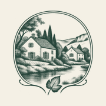

<div align="center">


<h3>A French guest portal for two holiday cottages in the Ardennes, opened by a scroll-driven 2.5D landscape where the houses part to let a brass thread through.</h3>

<p>
  <a href="https://gites-de-chooz.vercel.app"><strong>🌐 Live site</strong></a>
  &nbsp;·&nbsp;
  <a href="#hero-animation"><strong>🎬 How the hero works</strong></a>
  &nbsp;·&nbsp;
  <a href="#getting-started"><strong>🛠️ Run it locally</strong></a>
</p>

<p>
  <a href="https://gites-de-chooz.vercel.app"></a>
  
  
  
  
</p>

</div>

<br />

## 🚀 Overview

**Les Gîtes de Chooz** brings together two holiday homes on one shared property in Chooz, in the French Ardennes: **Le Grain d’Amour** (2 guests, 55 m²) and **La Brasserie** (12 guests, 240 m²). The owner wanted one green, calm entry point, reachable from a single QR code, that serves two kinds of visitors:

- **People planning a stay** compare the two gîtes, browse the official photos and continue to the right **Gîtes de France** booking page.
- **Guests already on site** open the **carnet de séjour** of their own gîte: Wi-Fi, recycling, energy, pool, pets and linen, arrival and departure, each with the conditions that apply to *that* house.

Around them sit **So Zen**, the yoga activities held on the terrace, and a short guide to the Meuse valley.

- **Cinematic first impression**: the approved architectural maquette is rebuilt from transparent layers and opens as you scroll, never blocking the page
- **Two clear paths**: book from the gîte pages, or open the guest booklet; both are one tap away in the mobile bar
- **Real places, real facts**: every photo of the houses is an official listing photo; capacities and conditions come from the listings, nothing is invented
- **Works for everyone**: every page is complete without JavaScript, the hero turns into a still image with reduced motion, and the booklet prints cleanly
- **Light**: 559 KB on the first desktop load and 331 KB on a phone, images included

All visitor-facing text is in French.

<br />

<a name="hero-animation"></a>

## 🎬 The hero animation

<div align="center">
  <a href="https://gites-de-chooz.vercel.app"></a>
  <sub>Scroll-scrubbed on the live site · captured at 1440 × 900</sub>
</div>

<br />

The hero is a short sticky section (0.7 screen height of scroll on desktop, 0.46 on phones) that follows the kit’s motion script, *Les maisons s’ouvrent sur le paysage*:

| Scroll   | What happens                                                                                          |
| :------- | :---------------------------------------------------------------------------------------------------- |
| 0%       | The two houses at rest on their paper tiers; title and **Découvrir les gîtes** visible                |
| 20–55%   | La Brasserie rises, Le Grain d’Amour settles a little: the tiers open                                 |
| 35–90%   | A brass thread draws itself through the gap between the tiers, then down past the river               |
| 70–100%  | The hero releases and the thread carries on into the next section, ending between the two gîte cards |

**Under the hood**

- 🧩 **Two transparent layers on a 1536 × 1024 stage**, positioned in percentages of the stage so the scene scales to any screen; the stage covers the hero with a focal point on the houses.
- 📐 **Measured, not guessed.** The kit said both layers shared the maquette’s canvas, but the lower one had been re-rendered: SIFT feature matching against the approved maquette measured it at **0.8745× scale, offset (161, 169) px** (the upper layer matched at 1.000). `scripts/prepare-hero.py` registers both, mirror-pads the edge that no longer reached the frame and checks the result side by side with the maquette.
- 🌫️ **No ghosts in the gap.** The background plate is the maquette with both tiers filled by push-pull interpolation, so the space revealed by the opening shows mist, never a second copy of a house.
- 🧵 **A thread drawn from the geometry.** The thread’s path follows the measured centre line between the two tiers at full opening, and sits between the layers: hidden under La Brasserie at rest, revealed as the tiers part. On scroll, its exit point is measured so the section below starts its own thread at the same spot.
- 🐢 **Graceful by default.** With `prefers-reduced-motion` the scene stays still, the thread is removed and nothing is pinned; without JavaScript the hero is a plain still. A `?p=0.5` flag freezes the hero at any progress for checks.

<br />

## 🖥️ Sections

<div align="center">
  
</div>

<br />

| #   | Page                                       | URL                                   | Role                                                                                         |
| :-- | :----------------------------------------- | :------------------------------------ | :------------------------------------------------------------------------------------------- |
| 01  | **La parenthèse verte.**                    | `/`                                   | Hero, the two gîtes, guest booklet teaser, So Zen and the Meuse outings                       |
| 02  | **Deux adresses. Votre échappée.**          | `/gites/`                             | Both gîtes side by side, a comparison table and the shared garden, pool and wellness area    |
| 03  | **Le Grain d’Amour** / **La Brasserie**     | `/gites/le-grain-damour/` · `/gites/la-brasserie/` | Facts, equipment, gallery of the official photos (11 and 23) in a dialog, conditions and booking |
| 04  | **Bienvenue chez vous.**                    | `/sejour/`                            | Choose your gîte to open its booklet                                                          |
| 05  | **Carnet de séjour**                        | `/sejour/le-grain-damour/` · `/sejour/la-brasserie/` | Eight practical points with the conditions of that gîte, printable                |
| 06  | **Au fil de vos envies.**                   | `/explorer/`                          | Voie Verte, Fort de Charlemont, Pâtisserie Léval, Presqu’île de Chooz, with filters           |
| 07  | **Un moment pour soi.**                     | `/so-zen/`                            | So Zen yoga on the terrace: identity, two real photos, Facebook and phone contact            |
| 08  | **Ce chemin s’est égaré.**                  | `/404.html`                           | Friendly not-found page                                                                       |

<br />

## 📱 Mobile first, motion optional

<div align="center">
  
</div>

<br />

- Title above the scene, a shorter opening and reduced amplitude, as the motion script asks
- A fixed bottom bar for the three things guests need most: **Les gîtes · Mon séjour · So Zen**
- Every touch target is at least 44 px; no horizontal scroll from 320 px to 1920 px (checked with the menu open)
- Phones download smaller hero layers: 153 KB of images on the first load
- Nothing depends on hover

<br />

## ✨ Highlights

- **🎞️ Scroll storytelling** without a library: one `requestAnimationFrame` loop maps scroll to the kit’s timeline (`07-integracao/timeline.json`)
- **🏡 One booklet per house**: Le Grain d’Amour and La Brasserie have different energy, pet and linen conditions, so each booklet has its own URL, a switcher, and a print layout
- **🖼️ Accessible gallery**: a native `<dialog>` where Escape closes, the arrow keys and swipes change photo, and focus returns to the photo you opened; without JavaScript each tile links to the full image
- **🔗 Real links only**: booking goes to the official Gîtes de France listings (08G430 and 08G339); prices and availability stay on the platform
- **🧾 Content rendered at build time** from one data file (`src/data/site.js`), so the site works without JavaScript and every fact has a single source
- **🖼️ Image pipeline**: the kit’s masters stay untouched; `npm run images` writes AVIF and WebP in up to three widths, with versioned names for immutable caching
- **🔎 Ready to share**: Open Graph image, page titles and descriptions; `noindex` stays on until the owner validates the content

<br />

## 💻 Tech stack

| <br />Vite 6 | <br />JavaScript | <br />HTML5 | <br />CSS3 | <br />Python | <br />OpenCV | <br />Vercel |
| :---: | :---: | :---: | :---: | :---: | :---: | :---: |

### Why this stack?

- **Vite + plain JavaScript**: ten static pages with three small modules (hero, gallery, filters); no framework runtime to ship
- **Build-time rendering**: a small Vite plugin renders every page from `src/data/site.js`, so content lives in one place and the HTML is complete before any script runs
- **Python + OpenCV, once**: registering the hero layers and building the background plate is a one-off measurement, kept as a script for when the art changes
- **sharp**: AVIF/WebP encoding from the kit’s original photos
- **Self-hosted Playfair Display and Jost**: a high-contrast serif with clean French accents, paired with a calm geometric sans, with no third-party font requests
- **Vercel**: every push to `main` deploys automatically

<br />

## 🎨 Design system

| Token        | Value                                                                        | Use                                              |
| :----------- | :--------------------------------------------------------------------------- | :----------------------------------------------- |
| Forest       |  | Text, hero, bands, footer, primary buttons       |
| Sage         |  | Numbers, quiet accents, panels (`#DFE3D6`)       |
| Linen        |  | Page surface, with a light paper grain           |
| Brass        |  | The thread, hairlines, link underlines           |
| Peach        |  | So Zen only, echoing its illustration            |

- **Type**: Playfair Display for headings (italic for the second half of each title), Jost for text; hero title 43–104 px, body 16–17 px
- **Shapes**: arched photos, torn-paper edges echoing the maquette’s tiers, botanical sprigs as quiet ornaments
- **Grid**: 1,320 px content width, side margins from 20 px (phones) to 72 px
- **Motion**: entrances of 26 px over 900 ms; the hero follows the scroll, everything else stays still with reduced motion

<br />

<a name="getting-started"></a>

## 🛠️ Getting started

```bash
# Clone the repository
git clone https://github.com/Jeanfr1/gites-de-chooz-website.git
cd gites-de-chooz-website

# Install dependencies (Node 20.9+)
npm install

# Start the dev server  →  http://localhost:5173
npm run dev

# Production build  →  dist/
npm run build

# Preview the production build  →  http://localhost:4190
npm run preview

# Re-register the hero layers on the maquette (Python 3 with OpenCV, NumPy)
npm run hero

# Regenerate every web image from the kit's masters
npm run images
```

<br />

## 📁 Project structure

```
gites-de-chooz-website/
├── index.html, gites/, sejour/, explorer/, so-zen/, 404.html   # Page entries (one marker each)
├── src/
│   ├── data/
│   │   ├── site.js             # Every fact on the site: gîtes, booklet, outings, So Zen
│   │   ├── hero.json           # Layer boxes, opening amplitude and thread path (generated)
│   │   └── images.json         # Image sizes for width/height and srcset (generated)
│   ├── render/                 # Build-time HTML: layout, pages, icons
│   ├── styles/main.css         # Tokens, components, responsive and print rules
│   ├── js/
│   │   ├── hero.js             # Scroll progress, opening, thread drawing and hand-off
│   │   ├── gallery.js          # <dialog> gallery: keys, swipe, focus return
│   │   └── filters.js          # Outing filters
│   └── main.js                 # Menu, reveal on scroll, print, page modules
├── scripts/
│   ├── prepare-hero.py         # SIFT registration, background plate, thread path
│   └── build-images.mjs        # AVIF/WebP pipeline (sharp)
├── public/img/                 # Encoded images (generated, versioned names)
├── 01-identidade … 09-qr/      # The design kit, kept as the source of truth (LEIA-ME-KIT.md)
└── vite.config.js              # Multi-page build + render plugin
```

<br />

## 🚀 Deployment

Hosted on **Vercel** and connected to this repository: every push to `main` ships to production.

**Live site:** [gites-de-chooz.vercel.app](https://gites-de-chooz.vercel.app)

| Setting          | Value           |
| :--------------- | :-------------- |
| Framework        | Vite            |
| Build command    | `npm run build` |
| Output directory | `dist`          |

The design kit folders stay in the repository but are excluded from the deployment (`.vercelignore`).

<br />

## 📌 Content checklist

Items waiting on the owner or on So Zen. Each one is marked `TODO(gites)` in the code.

- [ ] Final name: *Les Gîtes de Chooz* is provisional
- [ ] Arrival and departure times, keys, location of the bins and collection days, how the Wi-Fi details are handed over, pool rules, owner contact
- [ ] Owner’s confirmation for using the official Gîtes de France photos
- [ ] So Zen: dates, prices and how to sign up (the site sends visitors to Facebook and the phone number)
- [ ] So Zen illustration: the current file is a stock image that still carries its source’s watermarks; replace it with the licensed original or So Zen’s own artwork
- [ ] Whether the sauna, spa and hammam of the listings have anything to do with So Zen (kept separate for now)
- [ ] Gîtes 3 and 4, once their listings exist (no empty cards are shown meanwhile)
- [ ] Mentions légales and privacy page
- [ ] Final domain: then remove `noindex`, set `SITE_URL`, and generate the QR code with `09-qr/generer_qr.py`

Choices made where the kit contradicted itself:

- The editorial text file (`06-roteiros/CONTEUDO-FR.md`) wins over the words drawn in the mockups (for example, no “gîtes d’exception”)
- The study’s single page with `#` routes became real URLs, including one booklet URL per gîte
- The kit lists six photos per gîte; the gallery opens with those and adds the rest of each official listing

<br />

## 🙏 Acknowledgments

- **The owner of the gîtes** and **So Zen** for the brief, the photos and the approved visual direction
- **[Gîtes de France](https://www.gites-de-france.com)** for the listings the photos and facts come from
- **[Lucide](https://lucide.dev)** for the line icons the interface icons are based on (ISC)
- **[Playfair Display](https://fonts.google.com/specimen/Playfair+Display)** by Claus Eggers Sørensen and **[Jost](https://fonts.google.com/specimen/Jost)** by indestructible type* (OFL), via Fontsource
- **[OpenCV](https://opencv.org)**, **[sharp](https://sharp.pixelplumbing.com)**, **[Vite](https://vite.dev)** and **[Vercel](https://vercel.com)**

<br />

---

<div align="center">
  
  <p><strong>La parenthèse verte</strong></p>
  <p>Built with ❤️ by <a href="https://github.com/Jeanfr1">Jean</a> for Les Gîtes de Chooz</p>
  <sub>© 2026 Les Gîtes de Chooz. All rights reserved.</sub>
</div>
